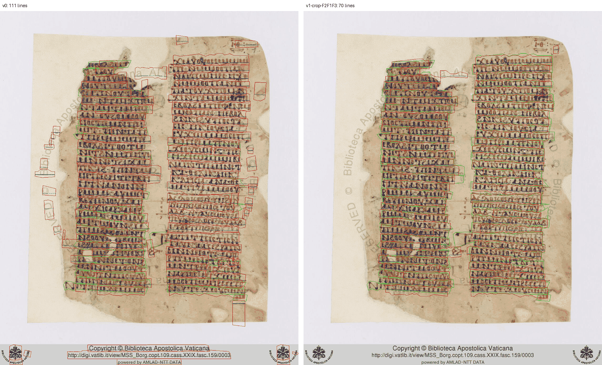
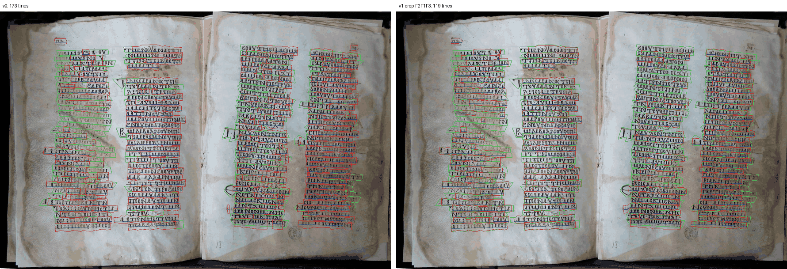

# Coptic segmentation experiments, 2026-09-18

Offline, on two Coptic manuscripts with verified ground truth. Everything calls
the production entry point `nomikos_inference.architectures.blla.run_blla_segment`
against the pinned `blla-segment@stable` artifact, so the V0 variant reproduces
production exactly. Nothing here touched the production API.

## What this run settled

1. The scale hypothesis is refuted. Production is already at the right scale.
   Upscaling and tiling make segmentation worse, not better. See "V5: the scale
   curve".
2. Orli beats the current segmenter by a wide margin on the same pages: F1 0.727
   to 0.852, fragments 116 to 6, and exact column counts 0 of 28 to 25 of 28. It
   is the largest result in this run. See "Orli".
3. Post-processing filters on today's output are worth about 0.09 F1 (0.642 to
   0.735 with crop plus F2, F1, F3). Useful, and much smaller than Orli.

## The question

The standing hypothesis was:

> pages are resized to a fixed 1800 px height, so lines come out too small for
> the model, which causes fragments; cropping and tiling would fix it.

**The hypothesis is false, and the sign is the other way round.** Making the
lines bigger in model pixels makes segmentation strictly worse, and fragments
rise monotonically with scale. The premise was already suspect: the Coptic
scans are small (Vatican 1136x1348, Napoli around 1400x940), so the 1800 px
resize *upsamples* them by 1.3x to 2.1x. The measurement confirms that
production is already at or slightly past the best scale.

## Data

33 ground-truth pages: Vatican Copt. Borg. 109 folios 1r..9v (18 pages, two
columns) and Napoli IB.10.10-27 c 10..c 24 (15 pages; each image is an opening
of two folios with columns LA, LB, RA, RB, except c 10 which has L and R only).

Verified before anything else: the recon coordinates are in source-image
pixels. An overlay of the ground truth on the raw scan lands on the ink for
both manuscripts.

**Bias warning.** The ground truth started life as the default kraken (V0)
output and was then corrected by hand. Between 16% and 85% of the lines on a
page still carry `source: "kraken"`, i.e. their geometry is literally a V0 box.
Every number below therefore favours the default variant, and the honest
reading of "V1 beats V0 by 0.02 F1" is "V1 is not worse", not "V1 is better".
The direction of the scale curve is much larger than this bias, so the verdict
on the hypothesis stands; the ranking of the near-ties does not.

Measured per page (full table in `out/csv/v0.csv`):

| | source size | scale to 1800 | median pitch, source px | median pitch, model px | median line height, model px |
|---|---|---|---|---|---|
| Vatican (18 pages) | 1136 x 1348 | 1.34 | 27-33 | 36-44 | 51-62 |
| Napoli (15 pages) | 812-1536 x 847-982 | 1.83-2.13 | 19-23 | 35-47 | 50-66 |

Every page already sits between 35 and 47 model pixels of line pitch. That is
the band BLLA was trained in; there was no starvation to fix.

## Metrics

`scripts/segmentation/experiments/score.py` is a standalone CLI that scores any
directory of predictions in the agreed JSON format. It knows nothing about
kraken, so the Orli predictions at `out/orli-fixed/` score through the same
code, against the same ground truth, with the same matching rule.

A prediction matches a ground-truth line when their baselines overlap
horizontally over at least half of the ground-truth extent and the median
vertical distance over that overlap is at most 0.25 x the local line pitch
(median baseline spacing of that ground-truth column); matching is one to one.
Unpaired ground-truth lines are don't-care: a prediction landing on one is
dropped from the scoring rather than counted against it.

False positives split into *spurious* (no relation to any ground-truth line at
all) and *duplicate* (a second box on a line another prediction already took).
Fragments and merges are counted on a looser relation graph (within 0.5 x pitch,
overlapping at least half of the shorter extent), which catches both a short
piece sitting on a long line and a long box spanning two lines across the
gutter.

## Runtime and what that forced

One page of V0 on this machine (Apple M4, CPU, single process, otherwise idle)
is **11.1 s**: 0.03 s preprocessing, **1.0 s** in the ONNX graph, **9.6 s** in
the decoder. The decoder, not the network, is the cost, and it scales with
image area, so tiling multiplies it.

The machine was shared with other agents for most of this run (load average
above 100 at times) and then rebooted mid-run, so the `seconds_per_page` column
in the CSVs is contended wall clock and should not be quoted as a cost model.
Use the 11.1 s figure.

That cost forced a subset. **V0 and V1 ran on all 33 pages. Everything else ran
on a 12-page subset**: Vatican 1r, 2v, 4r, 5v, 7r, 9v and Napoli c 10, c 13,
c 16, c 19, c 22, c 24 (34 columns, 1002 paired ground-truth lines). All
cross-variant tables below are scored on that same 12 pages so the comparison is
between variants and not between pages. V4 (column crops plus tiles), the 3x
scale point, the threshold sweep V6, and filters F4 and F5 were dropped for
time.

## V5: the scale curve, and the verdict

Effective scale is the multiplier on production's 1800 px resize. Below 1x the
page is pasted on a larger neutral canvas; above 1x it is cut into horizontal
tiles overlapping by two line pitches, segmented at 1800 each, mapped back, and
duplicates in the overlap removed (the longer baseline wins when two baselines
sit within 0.3 x pitch and overlap over half of the shorter one).

12 pages, overall:

| scale | median pitch, model px | precision | recall | F1 | fragments | exact-count columns |
|---|---|---|---|---|---|---|
| 0.50x | 19.9 | 0.564 | 0.649 | 0.604 | 112 | 1/34 |
| 0.75x | 29.8 | 0.559 | 0.678 | 0.613 | 121 | 0/34 |
| **1.00x (V0)** | **39.8** | **0.537** | **0.728** | **0.618** | **162** | 0/34 |
| 1.50x | 59.7 | 0.386 | 0.616 | 0.474 | 301 | 1/34 |
| 2.00x | 79.6 | 0.174 | 0.288 | 0.217 | 375 | 0/34 |

Fragments go 112, 121, 162, 301, 375 as scale rises. That is the exact opposite
of what the hypothesis predicted. F1 is flat between 0.5x and 1x (0.60 to 0.62)
and then falls off a cliff. At 2x the result is unusable.

Two honest caveats. First, the 1.5x and 2x points are tiled, so they carry
tiling artefacts (lines cut at a boundary, imperfect de-duplication) on top of
the scale change; part of the collapse is tiling, not scale. Second, the
untiled half of the curve is enough on its own to refute the hypothesis:
0.5x and 0.75x lose nothing in F1 and have *fewer* fragments than production,
so shrinking the lines does not cause the fragmenting the hypothesis blamed on
smallness.

## V0 to V3: variants

All on the same 12 pages, overall row.

| variant | precision | recall | F1 | fragments | merges | spurious | exact-count columns |
|---|---|---|---|---|---|---|---|
| V0 production | 0.537 | 0.728 | 0.618 | 162 | 57 | 263 | 0/34 |
| V1 oracle page crop | 0.557 | 0.722 | **0.629** | 194 | 76 | 153 | 0/34 |
| V3a oracle column crops | 0.548 | 0.721 | 0.623 | 210 | 67 | 145 | 0/34 |
| V3b `column_bands` crops from V0 | 0.628 | 0.501 | 0.557 | 88 | 36 | 91 | 2/34 |
| V5 1.5x tiles | 0.386 | 0.616 | 0.474 | 301 | 80 | 332 | 1/34 |
| V2 2 tiles (2x) | 0.174 | 0.288 | 0.217 | 375 | 80 | 412 | 0/34 |

On all 33 pages, V0 is F1 0.642 (precision 0.557, recall 0.757, 411 fragments,
748 spurious, 1/94 exact columns) and V1 is F1 0.660 (precision 0.587, recall
0.753, 501 fragments, 409 spurious, 3/94 exact columns).

V1 is the best plain variant, but read *why*. Its whole gain is precision:
spurious falls from 263 to 153 on the subset and from 748 to 409 on all 33.
Cropping to the text area removes the Vatican scans' copyright banner and the
"Biblioteca Apostolica Vaticana" watermark, which V0 happily segments as text.
13.8% of all V0 boxes on Vatican pages fall outside the text area; on Napoli it
is 0.05%, and V1 does not help Napoli at all (F1 0.678 to 0.669). Fragments go
*up* under V1 (162 to 194), consistent with the scale curve. So the crop is a
page-furniture fix, not a scale fix, and a fixed per-document crop rectangle
would capture all of it.

V1 is an **oracle** crop: it is the bounding box of the ground-truth lines plus
5%, standing in for a per-document crop rectangle that a human would draw once.
V3a is likewise oracle column bands. V3b is the realistic two-pass version
(`column_bands` from `segment_health.py` run on the V0 output): it buys a lot of
precision, 0.537 to 0.628, but loses a third of the recall, because the band's
vertical extent is taken from V0 boxes and clips lines at the top and bottom of
a column. It is the only variant that gets any column counts exactly right
without a filter, and it is the one to develop if the crop route is pursued.

The Napoli folio split (V3b-folio) and V4 did not finish; no claim is made
about them.

## Filters

All 33 pages, applied to V0 and to V1 (the best variant). "False deletes" counts
removed or merged-away boxes that were the one-to-one match of a real
transcription line. `out/csv/filters-v0.csv`, `out/csv/filters-v1-crop.csv`.

On V1 (F1 0.660, 3/94 exact columns before any filter):

| rule | removed | merged | false deletes | F1 after | missed after | exact columns after |
|---|---|---|---|---|---|---|
| F1 drop smaller of a >=50% overlapping pair | 2 | 0 | 0 | 0.660 | 681 | 3/94 |
| F2 merge same-baseline fragments (`find_fragments`) | 0 | 380 | 187 | 0.704 | 669 | 7/94 |
| F3 narrow and outside every band, top 12% exempt | 511 | 0 | 27 | 0.709 | 708 | 8/94 |
| F6 count-constrained ranking | 1890 | 0 | 810 | 0.571 | 1491 | 33/94 |
| **F7 = F2, then F1, then F3** | 303 | 380 | 204 | **0.735** | 688 | 13/94 |
| F2, F1, F3, then F6 | 1452 | 380 | 841 | 0.601 | 1407 | **35/94** |

On V0 the same chain gives 0.642 to 0.740, and F2,F1,F3,F6 gives 32/94 exact
columns. The pattern is identical.

Reading these:

* **F1 is dead weight here.** Two boxes out of 4409 overlap at 50% of the
  smaller area. Kraken's duplicates on these manuscripts are side-by-side
  fragments, not stacked twins.
* **F2 is free repair.** 380 merges, zero cost: missed goes *down* (681 to 669)
  because two halves become one matching line. The 187 "false deletes" are the
  fragment halves being absorbed, which is the intended behaviour, not damage.
* **F3 is the best single rule by ratio.** 511 boxes removed for 27 real lines
  lost, and it is exactly the rule that kills the Vatican banner and watermark.
* **F6 is a different trade entirely.** It is the only thing that moves the
  number that decides automatic pairing, 3/94 to 33/94 exact columns, and on
  Vatican alone it reaches 11 of 12 columns on the 12-page subset. It pays for
  it with 810 false deletes out of 1890 removals: 43% of what it drops is a
  real line. Its ranking (worst overlap, width below the column median, height
  deviation, ink density below the column median) picks the wrong box more than
  two times in five. It is not shippable as an automatic delete. It is
  shippable as "here are the k boxes we would drop, confirm".
* F4 and F5 were not run standalone. F5's ink-density measurement is
  implemented and is used inside F6's ranking, so it exists but has no
  standalone number.
* No rule needing a recogniser was attempted: `nomikos_inference/registry.yaml`
  has Greek, Syriac and Armenian Calamari entries and **no Coptic recogniser**,
  so there is nothing to read a candidate line with.

## Orli

Orli (`mittagessen/orli`, Apache-2.0) is the kraken author's end-to-end line
detector. It predicts baselines directly in reading order. The result here is
conclusive and positive.

### What we saw first, and why it was wrong

The first attempt looked like a total failure. Orli generated the same line over
and over until it hit the 200 line cap, and scored F1 0.065. That was not the
model. It was a mismatch between the code and the published weights.

Orli commit 7bf383e (2026-08-29) forced the curve refinement head to fp32 and
changed the `inverse_sigmoid` clamp. The published weights (2026-06-05) were
trained under bf16 semantics. Running those weights through the newer code
changes the numerics enough that the decoder never emits a stop, so it loops.
The author confirms this in https://github.com/mittagessen/orli/issues/10 and
has promised re-fine-tuned weights. Those weights were not on Zenodo as of
2026-09-18.

### The working recipe

| item | value |
|---|---|
| orli commit | 7996f29 (before the fp32 change) |
| kraken | 7.0.3 |
| precision | `bf16-true` |
| device | Apple M4, MPS |
| peak RSS | about 2.1 GB |

`bf16-mixed` is a no-op here. Orli never enters an autocast region, so the
mixed setting leaves the model in fp32 and the loop comes back. `bf16-true`
casts the weights themselves and is the setting that works.

### Measured result

Same 10 pages for both sides: Vatican 1r, 1v, 2r, 2v, 3r and Napoli c 10, c 11,
c 12, c 13, c 14. 851 ground-truth lines, 28 columns. Scored with the same
`score.py` and the same matching rule as every other variant.
`results/v0-same10.csv` and `results/orli-fixed.csv`.

| metric | kraken blla (V0) | Orli pinned |
|---|---|---|
| precision | 0.632 | **0.849** |
| recall | 0.854 | **0.856** |
| F1 | 0.727 | **0.852** |
| fragments | 116 | **6** |
| spurious | 228 | **36** |
| columns with the exact line count | 0 of 28 (0.000) | **25 of 28 (0.893)** |
| mean absolute column difference | 10.07 | **0.50** |
| seconds per page | 43.4 | **37.7** |
| predicted lines (851 ground truth) | 1167 | **874** |

Per manuscript:

| manuscript | kraken F1 | Orli F1 |
|---|---|---|
| Vatican (5 pages) | 0.549 | 0.714 |
| Napoli (5 pages) | 0.833 | 0.920 |

Both timings were taken on the same machine under the same load, so they are
comparable with each other. Neither is a production cost model.

Reading order was correct on all 10 pages.

### Independent check on two unseen pages

Two pages that were not in the 10:

| page | ground truth lines | kraken lines | Orli lines |
|---|---|---|---|
| vat-7v | 62 | 104 | 63 |
| c21 | 120 | 167 | 120 |

F1 on those two pages: kraken 0.474, Orli 0.639.

### Caveats

* The ground truth was built by correcting kraken output, so it is biased
  towards kraken. Orli wins anyway, which makes the margin a lower bound rather
  than an upper one.
* 12 pages of one script family. This is not a general verdict on Orli.
* Orli is PyTorch, not ONNX. The production segmenter runs ONNX on CPU, so Orli
  needs its own serving path.
* bf16 on the production CPU inference box is untested. It worked on Apple MPS.
  That does not carry over on its own.
* The published weights still need the pinned old commit. Re-fine-tuned weights
  from the author would remove that pin, and they are not out yet.
* Licence is Apache-2.0, which is fine for this platform.

## Overlays





Green is ground truth, red is the prediction, blue is the predicted baseline.
On Vatican 1r, V0 emits 111 boxes for 63 transcription lines, scattering them
over the watermark, the page edge and the copyright banner; the filtered crop
emits 70 and the margins are clean. On c 13 the page furniture is absent and
both sides look similar, which is the point: the crop is worth nothing where
there is nothing to crop away.

## What to do with this

1. **Put Orli behind a flag as a second segmenter.** It is the only change here
   that is worth more than a few points of F1, and it is the only one that moves
   exact column counts from 0 to 25 of 28. It needs a serving design first,
   because it is PyTorch and the production path is ONNX on CPU, and bf16 on
   that box is untested. Pin orli 7996f29 and kraken 7.0.3 until the author
   publishes re-fine-tuned weights.
2. Do not build tiling or upscaling. It is the wrong direction and it costs 2x
   to 3x the runtime to be worse.
3. Ship F2 unconditionally. It is a strict improvement on both manuscripts, and
   it stays useful for whichever segmenter runs.
4. Ship F3. 19 boxes removed per real line lost, and it is the rule that fixes
   the Vatican scans specifically.
5. Treat a per-document crop rectangle as a page-furniture feature, not a
   segmentation-quality feature, and expect it to do nothing for manuscripts
   photographed without a banner. Orli already ignores most of the Vatican
   furniture (spurious 228 to 36), so the crop matters less if Orli ships.
6. Automatic pairing is not reachable from today's geometry alone. The best
   unfiltered kraken variant gets 3 of 94 columns to the exact transcription
   count, and the count-constrained rule only moves that number by deleting real
   text 43% of the time, so it belongs behind a confirmation step. Orli reaches
   25 of 28 columns with no filter at all, which is the real route to automatic
   pairing.
7. The obvious untested lever on the kraken path is the decoder, not the input:
   9.6 of the 11.1 seconds and all of the fragmenting live there. The
   `heatmap_threshold` sweep (V6) was cut for time; a single spot check at 0.40
   on Vatican 1r returned zero lines, so the parameter is steep and worth a
   proper sweep. This is lower priority than item 1.

## Reproducing

```
GT=/Users/krishuagarwal/Desktop/Programming/python/greekOCR-wt/_gt-recon/human-guide/v4/recon
PY=/Users/krishuagarwal/Desktop/Programming/python/greekOCR/.venv/bin/python
cd <this worktree>
PYTHONPATH=$PWD:$PWD/nomikos $PY scripts/segmentation/experiments/run_variants.py --variants v0 --jobs 1
$PY scripts/segmentation/experiments/score.py --pred-dir scripts/segmentation/experiments/out/v0 \
    --gt-dir $GT --manifest /Users/krishuagarwal/Desktop/Programming/python/greekOCR/scripts/coptic/manifest.json \
    --out results.csv
```

The ground truth is the extracted `scripts/coptic/pairing-tools-2026-09-18.tar.gz`;
`run_variants.py --list` prints every variant name.

The two Orli tables come from these, run one after the other:

```
cd scripts/segmentation/experiments
$PY score.py --pred-dir out/orli-fixed --gt-dir $GT \
    --manifest /Users/krishuagarwal/Desktop/Programming/python/greekOCR/scripts/coptic/manifest.json \
    --repo-root /Users/krishuagarwal/Desktop/Programming/python/greekOCR \
    --out results/orli-fixed.csv
$PY score.py --pred-dir out/v0-same10 --gt-dir $GT \
    --manifest /Users/krishuagarwal/Desktop/Programming/python/greekOCR/scripts/coptic/manifest.json \
    --repo-root /Users/krishuagarwal/Desktop/Programming/python/greekOCR \
    --out results/v0-same10.csv
```

`out/` is git-ignored, so the predictions themselves are local only. The scored
per-page CSVs are committed under `results/`.
