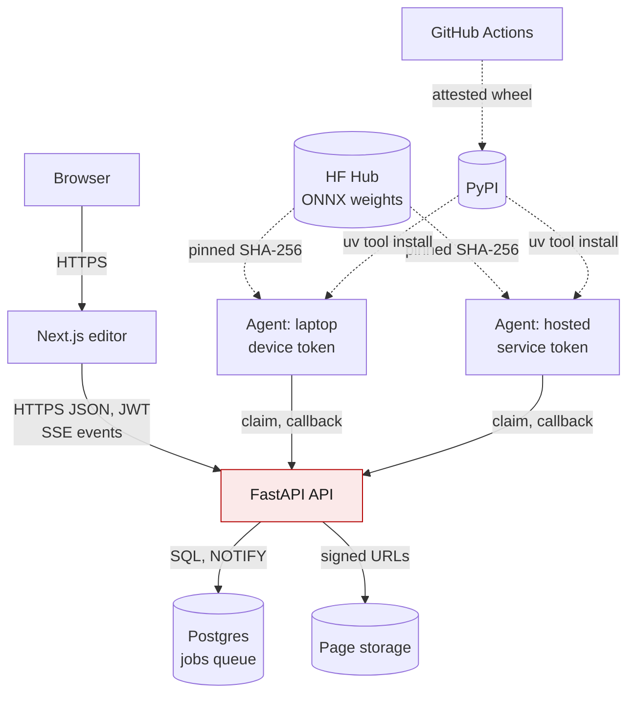
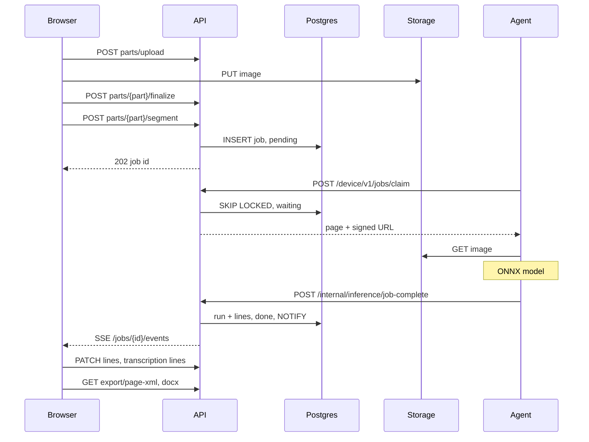
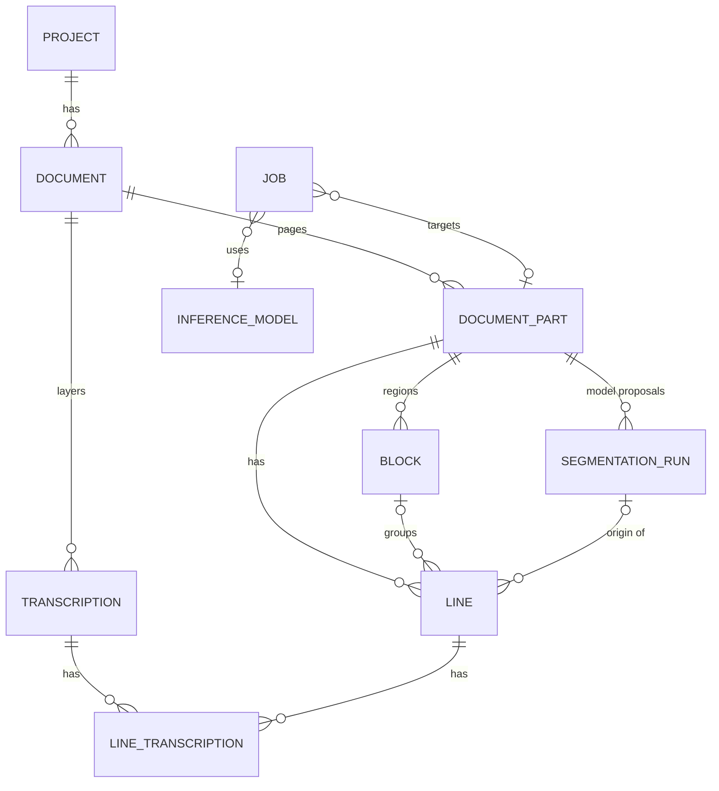

# Nomikos: software engineering report

Snapshot of `main` at `a68cf6fa` (2026-10-30). Every claim names the file it comes from.

**Reader and concern.** Partner: can it be deployed and run? Supervisor: is the output correct and traceable? Next maintainer: where does each thing live?

## 1. Purpose and quality goals

Nomikos is a handwritten text recognition (HTR) platform for manuscripts. A researcher uploads page images, runs a segmenter and a recogniser, corrects the result in a browser editor, and exports it (PAGE XML, docx, PDF, text). The corrections are the product: the platform exists to turn model proposals into ground truth (ADR `0013`).

Quality goals, in order: (1) model output on the platform equals model output on the training machine; (2) no human correction is lost or silently overwritten; (3) inference runs on a researcher's own CPU or on a hosted worker with the same code; (4) the browser never touches the database or storage directly (`docs/architecture.md`, "Security boundaries").

## 2. Containers and connections

*Figure 1. Container view (C4 level 2). Solid arrows: runtime requests. Dashed arrows: artifacts (weights, packages). Accent: the one component with database credentials. Storage is local or Supabase (`MediaStore`).*

Three deployable units share one repository:

- **Frontend** (`nomikos/frontend/`): Next.js 16 and React 19, client rendered, Ant Design and TanStack Query. Its API client is generated: `scripts/platform/export_openapi.py` writes `openapi/openapi.json` (about 115 operations) and `openapi-typescript` turns it into `src/api/schema.d.ts`.
- **Platform API** (`nomikos/backend/`): FastAPI, split into bounded contexts (`users`, `project`, `document`, `annotation`, `ml`, `jobs`, plus `core` as composition root). Each context has `api/` (routers, DTOs), `application/` (use cases, access checks, transactions), `domain/` (pure rules) and `infrastructure/` (SQLAlchemy, repositories) (`nomikos/backend/README.md`). Media storage sits inside `document` behind a `MediaStore` protocol with local and Supabase implementations (`document/infrastructure/media_store/factory.py`).
- **Inference agent** (`nomikos_inference/`): the only package published to PyPI. It has no database, no queue and no listening port; it calls the API outbound and runs ONNX Runtime on CPU (`nomikos_inference/README.md`).

Schema lives in Alembic migrations `001` to `011` under `nomikos/infrastructure/alembic/versions/`.

## 3. Runtime: one page, end to end

*Figure 2. Process view: segmenting, correcting and exporting one page. Paths without a leading slash sit under `/projects/{p}/documents/{d}/`.*

Three mechanisms make this loop robust. Claims use `FOR UPDATE SKIP LOCKED`, one page per claim, so many agents can share the queue (`docs/database-design.md` 8.1). A crashed agent's page returns to `pending` after its lease, and after `MAX_CLAIM_ATTEMPTS = 5` abandoned claims it is failed as poison (`jobs/infrastructure/job_claim_engine.py`). Callbacks lock the job row and set `callback_claimed_at` before merging, so a retried callback cannot merge twice (8.3). If SSE is unavailable, the browser polls `GET /jobs/{id}`.

## 4. Data model

*Figure 3. Core entities (identity, sharing, devices and history tables omitted).*

The model layer and the human layer are kept apart. A `segmentation_runs` row stores a segmenter's output verbatim as JSONB, with the model's name, registry id and artifact reference copied in as text, so identity survives deletion of the job. Nothing updates it (migration `011_model_output_provenance`). Live `lines` point back to their run. Transcriptions follow the same rule: each recogniser run is its own `model` layer and human text lives in the single `ground_truth` layer, enforced by a partial unique index.

## 5. Key decisions

| ADR | Decision | Reason | Consequence (benefit and cost) |
|---|---|---|---|
| `0003` | One queue (`jobs`); the hosted worker claims over HTTP like a laptop. | A second `inference_jobs` table doubled claim loops, locks and databases. | Local and cloud run identical code. Cost: the hosted worker depends on API availability. |
| `0005` | The credential fixes the execution target (device token: own `local` jobs; service token: any `cloud` job). | Nothing in a request body may widen access. | Simple authorisation. Cost: a service account and its device row to manage. |
| `0006` | ONNX Runtime serves; PyTorch only exports (`nomikos_inference/export/`, outside the wheel). | PyTorch made the install 817 MB on macOS arm64 and raised peak RAM from 3.0 to 7.0 GB. | Small CPU install. Cost: an export step with parity tests in `tests/export/`. |
| `0007` | Serving preprocessing reproduces the training loader exactly, crop padding recorded per model. | Pages in the training data came back wrong because serving dewarped, inverted and padded. | Parity is testable. Cost: each model carries its own crop settings in `registry.yaml`. |
| `0008`, `0011` | The server owns dense reading order, region first. | Three writers left gaps and collisions in `Line.order`. | All surfaces agree. Cost: every line write renumbers the page under a lock. |
| `0013` | Model output is an immutable layer beside the human correction. | Edits overwrote proposals, so deleted false positives left no trace. | Corrections become training data. Cost: runs are kept forever, no pruning yet. |

ADRs are immutable once merged; a reversal gets a new record (`0004` is superseded by `0006`) (`docs/adr/README.md`).

## 6. Quality, security and deployment

**Tests.** `tests/nomikos/` (unit, and integration against real Postgres), `tests/inference/` (unit, integration, and `-m ml` on real weights), `tests/export/` (ONNX vs PyTorch parity), `tests/hf/`, plus Locust load tests in `tests/load/`. Markers are strict (`pyproject.toml`).

**CI** (`.github/workflows/`, all actions pinned by commit SHA):

- `quality.yml`: frontend `tsc`, eslint, vitest, build; ruff and mypy; unit tests; Postgres 16 integration after `alembic upgrade head`; nightly real-weights lane; `check:api`, which regenerates the OpenAPI artifacts and fails on any diff, so they are never hand edited.
- `security.yml`: gitleaks with the shared `infrastructure/gitleaks.toml`, `npm audit`, `pip-audit` with documented VEX exceptions (`docs/security/`).
- `deployment.yml`: builds the Vercel bundle and both Docker images, SBOMs, Trivy scans.
- `release.yml`: wheel, SBOM, Trivy gate, provenance attestation, PyPI trusted publishing.

Pre-commit runs ruff, gitleaks, eslint, prettier and the OpenAPI regeneration (`.pre-commit-config.yaml`). Recent work lands as squash-merged pull requests titled `(#NNN)`; commit bodies and tests cite Greptile review findings (for example `tests/nomikos/unit/test_segment_health_service.py`).

**Deployment.** `infrastructure/docker-compose.yml` runs the dev stack (`db`, `api`, `platform-worker`, `frontend`); `docker-bake.hcl` builds the images; `infrastructure/platform/` bundles the API for Vercel. `docs/deployment/production.md` lists `nomikos.app`, `app.nomikos.app` and `api.nomikos.app`. The hosted agent is `nomikos run` under a systemd unit on a CPU host (`docs/deployment/cloud-inference-worker.md`); there is no inference service to deploy.

## 7. Limits and next steps

- **mypy does not gate.** It runs with `continue-on-error: true` and names a path, `inference`, that no longer exists (`quality.yml`).
- **Context cycles.** `document`, `annotation`, `ml` and `jobs` import each other both ways; the layering holds inside a context, not between them.
- **Documentation drift.** `docs/database-design.md` 5.4 still warns that the callback blocks the event loop, but `jobs/application/job_callback_service.py` now runs the merge in `asyncio.to_thread`. `production.md` describes Vercel and Supabase while its release section names a Coolify host for the API. One source of truth per fact is needed.
- **Observability is per process.** Request metrics are in-memory counters, not persisted and not summed across replicas (ADR `0010`).
